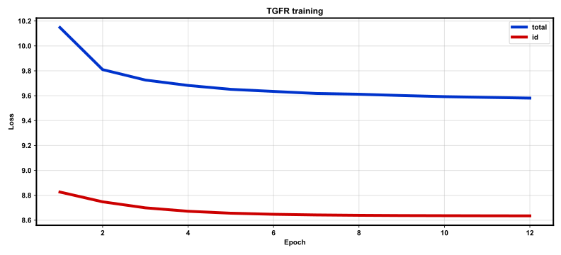
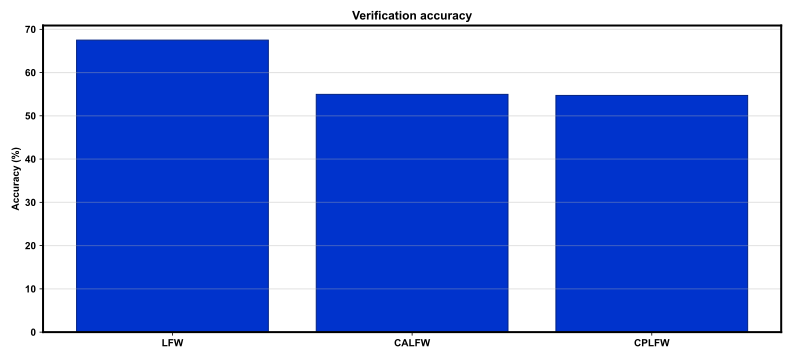

# REPORT: Text-Guided FR (MSFA-lite) — full

**Protocol:** `full`  
**Package:** `tgfr`  

## Summary

| Benchmark | Accuracy | EER | Pairs |
|-----------|----------|-----|-------|
| LFW | 67.50% | 32.50% | 6000 |
| CALFW | 54.97% | 45.03% | 6000 |
| CPLFW | 54.72% | 45.28% | 6000 |

## Training

- Epochs: 12
- Train images: 141610
- Identities: 7124
- Elapsed: 2111.65 s
- Checkpoint: `outputs/checkpoints/full/last.pt`

## Figures

### `train_loss.svg`



### `bench_acc.svg`



## Reproduce

```bash
bash scripts/smoke.sh
bash scripts/train_full.sh
```

## Notes

- CelebA attributes used as caption proxies (GPTFace omitted; see DEVIATIONS.md).
- Eval on LFW / CALFW / CPLFW; WebFace260M / AgeDB omitted.
